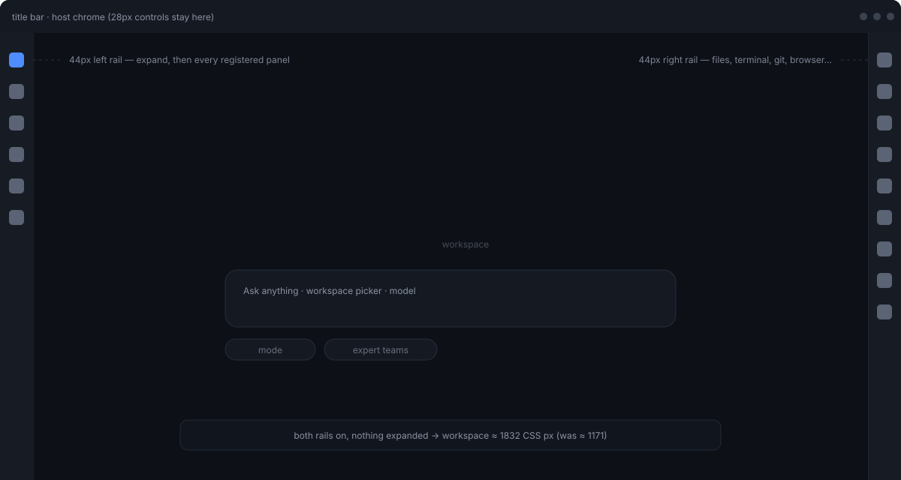

# dsh-activity-bar

<p align="center">
  <a href="./LICENSE"></a>
  
  
  
</p>

<p align="center">
  把 DeepSeek Harness 两侧栏收起后的空位，变成 VS Code 那样的窄图标条，把宽度还给工作区。<br>
  <sub>中文 · <a href="./README.md">English</a></sub>
</p>



> **版本**：`0.1.0`。两个开关、左右两条竖条、设置页都已实现，并通过离线自测脚本；真机截图待补（见[界面截图](#界面截图)）。设计与取舍见 [docs/DESIGN.md](docs/DESIGN.md)。

---

## 为什么

DSH 的左侧栏和右侧栏默认常驻，一起吃掉接近四成的窗口宽度。以 1920 CSS 宽的窗口实测，竖条宽 44px：

| 配置 | 左 | 中间工作区 | 右 | 中间相对现状 |
| --- | ---: | ---: | ---: | ---: |
| 现状（两侧栏都展开） | 279 | 1171 | 466 | — |
| 只开右条 | 279 | 1597 | 44 | **+36%** |
| 只开左条 | 44 | 1410 | 466 | **+20%** |
| 两条都开 | 44 | 1832 | 44 | **+56%** |

入口一个都不会消失：原来侧栏里的每一项，都变成竖条上的一枚图标，悬停出名称，点击即达。

> 上面这组数字只描述「面板都收起」的时候。一旦你点开一个工具，右侧 300–466px 的面板会回来，宽度也就还回去了。这点在[已知限制](#兼容性与已知限制)里写清楚了，不藏着。

## 功能

- **左侧活动栏** —— 桌面端侧栏展开、收起都有一条 44px 竖条，条目是宿主里注册的每个面板（插件、定时任务、记忆…），图标直接用插件自己画的那一个
- **右侧活动栏** —— 右栏展开、收起都有一条 44px 竖条，条目实时取自右栏自己的引导账本（文件、上下文、Git、终端…）
- **只为内容让路** —— 竖条不压在面板上：整个网格（侧栏列、会话列、右栏列，连同右栏自己的头部与收起按钮）一起向内让出 44px，竖条站在让出来的那条空隙里，宿主的列宽、拖拽与动画都不受影响
- **左侧面板只留工作区** —— 竖条接管面板入口之后，侧栏自己那份导航（插件、定时任务…的列表）隐藏，展开后只剩工作区树与会话列表
- **底部脚部条** —— 侧栏原本贴在底部的动作行（DS Bot、记忆、设置、账号…），连同别的插件塞进这块的「远程」入口，一起搬进一条钉在竖条自身坐标系上的窄条：只留图标、单列 32px、每个图标都落在竖条中线上，账号头像排在最后
- **右栏宽度可拖** —— 宿主自己的分栏把手只在右栏非全屏时存在，插件因此在面板左缘画了一条：拖动同时改网格第三轨和面板本身的宽度，宽度夹在 300px 与窗口 60% 之间，记在 `localStorage` 里；宽度只在面板展开时写入，收起后不占轨，展开那一刻按记住的宽度重写
- **两个开关** —— 左侧、右侧各自可关闭，关掉后该侧完全回到 DSH 原样
- **自动跟随，不硬编码** —— 竖条不写死入口名单：DSH 装卸任何注册了面板或右栏工具的插件，竖条自动增减
- **点开即收起** —— 右侧图标是开关：面板没开就打开，面板已开着再点同一个图标就收起
- **跟随主题** —— 只用宿主设计令牌，明暗主题自动切换
- **键盘可达** —— 每个入口都有本地化 `aria-label` 与悬停提示，Tab 能走完，回车即触发

## 界面截图

| 图 | 内容 | 文件 |
| --- | --- | --- |
| 1 | 侧栏收起后的左侧 44px 竖条 | `docs/images/shot-left-rail.png`（待补） |
| 2 | 右侧竖条与已打开的工具面板 | `docs/images/shot-right-rail.png`（待补） |
| 3 | 设置页里的两个开关 | `docs/images/shot-settings.png`（待补） |

三张都由作者自己在真实窗口里截，不用示意图顶替。补图前先看[布局示意](docs/images/layout.svg)。

## 安装

前置条件：DeepSeek Harness `0.2.1-rc.3` 或更新的版本，Node `>= 22.13`。

装完都要重启 DSH，插件在启动时挂载。

### 方式 A：让 DSH 自己装（推荐）

在 DSH 对话里说一句：

> 帮我安装这个插件：`dsh-activity-bar`，仓库在 `D:/Project/Honey/dsh插件开发/dsh-activity-bar`

它会执行方式 B 那条命令。

### 方式 B：一条命令（已实测）

```bash
dsh plugin --profile desktop add "dsh-activity-bar@link:D:/Project/Honey/dsh插件开发/dsh-activity-bar"
```

`dsh` 在 `<DeepSeek Harness>/resources/runtime/cli/bin/dsh.cmd`。这条命令在 profile 目录里跑 `pnpm add`，并顺手做两件关键的事：写进 `dependencies`，再把这个包名追加进 `dsh.profile.bundles`。

之所以要进 `bundles`：本插件靠**自己的** `cordis.patch.yml` 把自己插进 loader，profile 只要承认它是个 bundle 就够了。自己在这个 yaml 里再手写一条 `- insert:` 会造成挂载两次。

### 方式 C：手工改 profile 文件

profile 目录是 `<DSH_HOME>/profiles/<profile>`（Windows 下通常是 `C:\Users\<你>\.dsh\profiles\desktop`）。

1. 在 `package.json` 的 `dependencies` 里加一条：

   ```json
   "dsh-activity-bar": "link:D:/Project/Honey/dsh插件开发/dsh-activity-bar"
   ```

2. 在同文件的 `dsh.profile.bundles` 数组末尾加一项：

   ```json
   "dsh-activity-bar"
   ```

3. 在该目录执行 `pnpm install`（会把仓库目录链进 `node_modules`），然后重启 DSH。

### 方式 D：从源码开发

```bash
git clone <repo> dsh-activity-bar
cd dsh-activity-bar
```

按方式 B 或 C 挂进 profile。**没有构建步骤**：`lib/index.js` 与 `lib/client.js` 都是手写 JS，改完刷新页面就生效（挂载本身改动需要重启）。装了 `dsh-client-hmr` 的话连刷新都省了。

## 使用

### 左侧竖条

| 动作 | 结果 |
| --- | --- |
| 点面板图标（插件 / 定时任务 / 记忆 …） | 中间区换成该面板；侧栏收起时先把它展开，竖条保持不动 |
| 再点当前已激活的图标 | 面板保持打开，图标带左侧高亮竖条 |
| 点下半段的图标（DS Bot / 记忆 / 设置 / 账号 …） | 触发宿主原本贴在侧栏底部的那个动作 |
| 悬停 0.5 秒 | 出名称提示 |

左侧竖条的显示规则：

- **Windows 与 macOS 桌面端**：常驻。整个网格左缘让出 44px，竖条站在那里；侧栏展开时它是面板入口，侧栏收起后整列宽度变成 0，宿主不在那里放任何东西，竖条就是唯一入口。
- **普通 Web 端**：侧栏展开时出现。收起后宿主自己会留一条约 56px 的图标轨，此时插件不再画第二条，避免同一入口出现两遍。
- 判定依据是宿主在 `<html>` 上写的标记：Windows 桌面用 `data-windows-titlebar`，macOS 桌面用 `data-platform="darwin"`，两者都没有就是普通网页。

### 右侧竖条

| 动作 | 结果 |
| --- | --- |
| 点工具图标 | 右栏展开并打开该工具 |
| 再点同一个图标 | 右栏收起，竖条留在原处 |
| 右栏展开期间 | 竖条照常显示；整个网格右缘让出 44px，右栏头部与收起按钮一起左移，不再被挡住 |
| 右栏里一个工具都没注册 | 不绘制竖条 |

| 快捷键 | 动作 |
| --- | --- |
| <kbd>Ctrl</kbd>+<kbd>`</kbd> | 新建终端（宿主既有） |
| <kbd>Ctrl</kbd>+<kbd>T</kbd> | 打开浏览器（宿主既有） |

### 开关在哪

设置 → **活动栏**，两行开关，翻一下立即生效，不需要重启。

## 配置

| 键 | 类型 | 默认 | 说明 |
| --- | --- | --- | --- |
| `left` | boolean | `true` | 启用左侧活动栏；关闭后左侧完全回到 DSH 默认行为 |
| `right` | boolean | `true` | 启用右侧活动栏；关闭后右侧完全回到 DSH 默认行为 |

两开关存在本机浏览器的 `localStorage` 里，键名 `dsh-activity-bar.prefs`，值是 `{"left":true,"right":true}`。这样做的原因：DSH 的设置服务只对白名单命名空间开放，第三方插件在 Client 半侧读不到自己的 Config，为了两个布尔值去搭一条宿主 HTTP 路由不划算。

要把它变成「装好就默认关闭」，改 `lib/client.js` 里 `readPrefs()` 的默认值即可。

## 图标对照表

竖条优先渲染插件自己为面板注册的那个图标组件；拿不到组件、或组件在竖条环境里报错，才按入口的 id / kind 退到内置图标，都不匹配用圆点兜底。

| 位置 | 入口 | 内置图标 | 说明 |
| --- | --- | --- | --- |
| 左 | 插件 | 拼图 | 插件管理与浏览 |
| 左 | 定时任务 | 时钟 | 自动化任务列表 |
| 左 | 上下文洞察 | 透视 | 上下文用量与构成 |
| 左 | 记忆 / 记忆库 | 大脑 | 记忆入口 |
| 左 | 其它已注册面板 | 圆点 | 形如 `plugin*`、`schedul*`、`context*`、`memor*` 会命中上表 |
| 右 | 文件 | 文件夹 | 工作区文件 |
| 右 | 上下文 | 图层 | 上下文面板 |
| 右 | 新建终端 | 终端方块 | 独立终端实例 |
| 右 | Git | 分支 | 仓库状态与提交 |
| 右 | 浏览器 | 地球 | 应用内浏览器 |
| 右 | 任务管理 | 清单 | 队列与后台任务 |
| 右 | 侧边对话 | 对话气泡 | 旁路问答（beta） |
| 右 | 记忆库 | 笔记本 | 跨会话记忆 |

名单看着长，其实全是从注册表实时读出来的：DSH 装卸插件后竖条自动增减，不需要改本插件。

## 兼容性与已知限制

- 在 DSH `0.2.1-rc.3` 上按真实 DOM 与客户端 API 开发。插件依赖这些宿主接口，升级后需要复测：`shell.overlay`、`settings.section`、`sidebar.panellist` 插槽、`layout.selectPanel / toggleSidebar / closeRightbar / panelInfo`、`sidebarRightTabs.guide()`、`sidebarRight.openTab / active / isExpanded`、`html[data-platform]` 与 `html[data-windows-titlebar]` 两个属性。
- 给竖条让路的方式是在 frame 上留 `padding`；插件唯一会写的内联轨是右栏那第三条，而且只在用户拖过插件画的分栏把手之后才写，左侧列与 `1fr` 中列仍归宿主管；代价是「侧栏宽度 280、内容区 226」，设置里读到的仍是 280。左侧留在侧栏内层盒子上，右侧留在右栏整列上：右栏的头部与收起按钮是宿主自己画的，只有整列让开它才不会落进竖条底下。早先给列加 `margin` 的写法在侧栏展开时会把宿主固定 280px 的内层盒子挤出网格列，右侧内容被裁掉，已改掉。
- 面板图标渲染的是插件自己注册的那个组件（`sidebar.panellist` 插槽条目的 `component`）。某个插件的图标组件若依赖它拿不到的上下文，错误会被这一格的错误边界接住、退回内置图标，竖条本身不受影响。
- 普通 Web 端收起侧栏时不画左条（宿主自带图标轨），需要先展开侧栏再看竖条。
- macOS 桌面端已按 `data-platform="darwin"` 与 `--dsh-frame-top-clearance`（48px）做了避让，但没有 macOS 设备实测，首次使用请留意竖条是否压到左上角红绿灯按钮。
- 打开右侧面板时中间区会随右栏一起变窄，竖条省下的宽度只在面板收起时生效。
- 脚部条是 `position:fixed` 钉在竖条自己的边框盒里（`left:0`、`width:44px`），不再靠「量宿主的 padding 链再算位移」对齐，所以不会再因为宿主多包一层就整体偏几像素。条目多了会让这块区域出现滚动；标签文字由 JS 打 `data-dsh-ab-label` 后 `display:none` 彻底离开布局（只把字号设 0 时盒子还占宽度，图标就被挤偏），名称由悬停提示给出。账号那一行靠它自己的文案（`登录`、`account`、`profile`、`用户` 等）认出来排到最后，文案不同的版本就保持宿主原有顺序。
- 侧栏宽度的下限由宿主限定在 264px，插件无法提供「比 264 更窄但仍展开」的中间态。
- 竖条里没有「新会话」按钮：Windows 收起态下宿主已经把它固定在标题栏 `left:48px`，再放一个就是两个入口。
- 竖条里没有左侧的「更多」菜单：它是菜单不是面板，宿主自己把它挂在面板列表末尾，收起态下随整列一起隐藏。
- 插件不接管工作区树与会话树：要看到会话列表，得先展开左侧栏。
- 未做图标顺序自定义、单条竖条自身宽度可调、主题色自定义、拖拽调整竖条自身宽度（右栏面板宽度可以拖，见上）。
- 窄屏（<1024 自动收起侧栏、<768 右栏全屏）的组合行为尚未在真机逐项实测。

## 卸载

1. 把包从 profile 摘掉：`dsh plugin --profile desktop remove dsh-activity-bar`；或者手工从 `package.json` 的 `dependencies` 和 `dsh.profile.bundles` 里各删掉那一项（`bundles` 里漏删会让 loader 找不到包而报错）。
2. 在 profile 目录执行 `pnpm install`，重启 DSH。
3. 插件会在卸载时摘掉自己写的属性与 CSS 变量；`localStorage` 里那条偏好留着无害，想清干净就在开发者工具里删掉 `dsh-activity-bar.prefs`。

## 开发

```text
dsh-activity-bar/
├── package.json          # dsh.bundle.patch 与 dsh.client.platform / inject
├── cordis.patch.yml      # 插件的 loader 行
├── lib/
│   ├── index.js          # Host 半侧：空实现，功能全在客户端
│   └── client.js         # Client 半侧：两条竖条 + 设置页
├── locale/
│   ├── en.json
│   └── zh.json
├── scripts/
│   └── smoke.mjs         # 离线自测：假 DOM + 假 React，加载真实 client.js 跑断言
├── docs/
│   ├── DESIGN.md
│   └── images/
├── README.md
└── README.zh-CN.md
```

- 改 Client 半侧后刷新页面即可，没有编译步骤。
- 自测：`node scripts/smoke.mjs`，全部通过时打印 `smoke: all assertions passed`。它用 `node:vm` 加载真实的 `lib/client.js`，断言样式注入、两处 slot 注册、竖条按钮顺序与 `aria-label`、点击路由、三个标记属性、开关持久化、脚部条的钉死坐标与 auto 外边距居中、一次真实拖拽（改轨 + 改面板宽度变量，夹紧并持久化宽度）、收起状态下不写宽度与不钉面板、展开后手柄即刻出现。
- 样式只用 `--dsw-*` 令牌，不写死色值，也不依赖 DSH 生成的哈希类名。
- 只往 `shell.overlay` 这个既有容器里挂内容，不往 `document.body` 追加节点，不替换应用根节点。
- 除用户拖拽后写入的那条右栏轨之外，布局不碰宿主的 `grid-template-columns`：给竖条让路靠 frame 上的 `padding`，竖条与脚部条都是 `position:fixed`，宿主自己的分栏把手仍然可用。

## 自测清单

发版前逐项打勾，全部由作者自己跑，不请他人代测：

- [x] A0 `node scripts/smoke.mjs` 全绿
- [ ] A1 1920 视口、右栏收起、只开右条：中间区 ≥ 1580
- [ ] A2 同上、两条都开：中间区 ≥ 1810
- [ ] A3 关掉右条开关并刷新：右条消失，右栏回到默认行为
- [ ] A4 关掉左条开关并刷新：左侧回到默认展开
- [ ] A5 当前环境里注册的每个入口逐个可点，中英文悬停提示齐全，Tab 全部可达
- [ ] A6 明暗两主题下图标与底色对比度 ≥ 3:1
- [ ] A7 连续开合 20 次无控制台错误
- [ ] A8 卸载后无残留节点、无残留属性
- [ ] A9 1280×800 与 1024×700 下无死按钮、无裁剪、无双导航

## 许可证

[MIT](./LICENSE)
