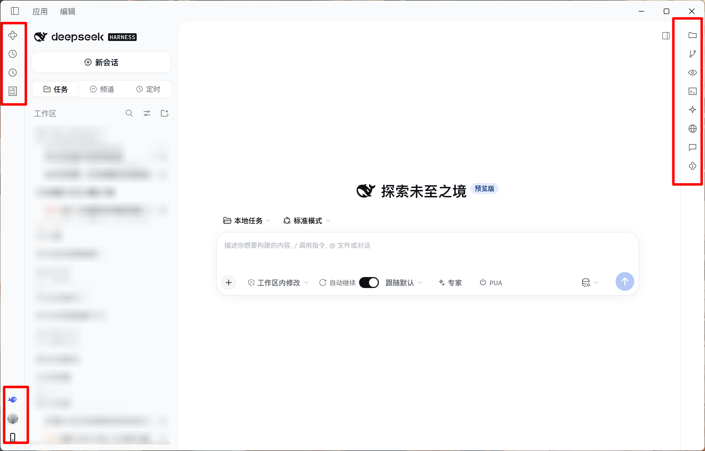

# dsh-activity-bar

<p align="center">
  <a href="./LICENSE"></a>
  
  
</p>

<p align="center">
  把 DeepSeek Harness 两侧栏收起后的空位变成 VS Code 那样的窄图标条，把宽度还给工作区。<br>
  <sub>中文 · <a href="./README.md">English</a></sub>
</p>



## 它做什么

DSH 的左侧栏和右侧栏默认常驻，两条一起吃掉近四成窗口宽度。装上这个插件之后：

- **两条 44px 竖条** —— 左、右各一条常驻图标条，图标来自宿主注册表，装了什么插件就长什么条目
- **只为内容让路** —— 竖条不压在面板上，整个网格向内让出 44px，列宽、拖拽、动画都还是宿主的
- **入口一个不少** —— 原来贴在侧栏底部的动作行（DS Bot、记忆、设置、账号，以及别的插件塞进来的「远程」）变成竖条底部的一条，图标只留图形、逐个居中
- **右栏宽度可拖** —— 在右栏左缘拖一条把手，宽度夹在 300px 与窗口 60% 之间，记住上次的宽度
- **随便关掉一边** —— 设置 → **活动栏**，左右两个开关，翻一下立即生效，关掉的那侧完全回到 DSH 原样

## 适应版本

DeepSeek Harness `0.2.1-rc.3` 及以上（Node `>= 22.13`）。

## 安装

用 git 装，一条命令：

```bash
dsh plugin --profile desktop add "dsh-activity-bar@git+https://github.com/XenoPhonLau/dsh-activity-bar.git"
```

`dsh` 在 `<DeepSeek Harness>/resources/runtime/cli/bin/dsh.cmd`，`--profile` 换成你要装的那个 profile。命令会把包写进该 profile 的依赖，并自动登记进 `dsh.profile.bundles`。

装完**重启 DSH**，插件在启动时挂载。

升级时重跑同一条命令：

```bash
dsh plugin --profile desktop update dsh-activity-bar
```
